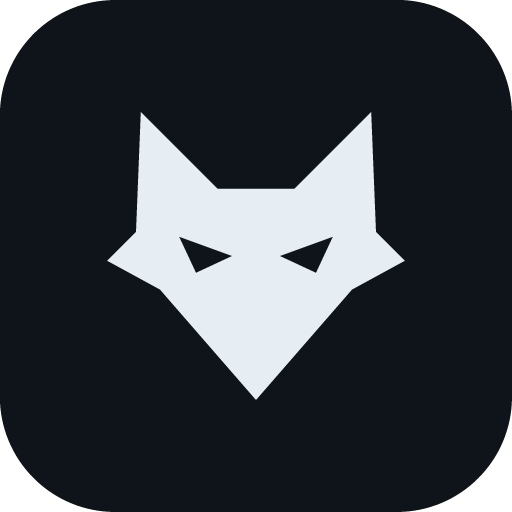

  

<h1 align="center">Wolfpack</h1>

A pack of AI agents that live on your Mac, remember what you tell them, and share what they learn.

## What it is

Wolfpack gives you a **pack**: one or more long-lived AI agents called **wolves**. A wolf is not a chat window you close and forget. It keeps working between conversations, has its own memory, and can send smaller agents off to do the legwork while it talks to you.

- **Wolves** – each one has a name, a job and its own workspace. You start with one, the alpha, and add more when you need them.
- **Memory** – a wolf watches what you talk about, writes down what matters, and folds it into topics it reads again next time. You see every note and can tidy them yourself.
- **Shared knowledge base** – what a wolf learns is curated into a knowledge base the whole pack reads, organised by domain (your projects, your life, your company). Nothing leaves your machine unless you add another machine to the pack.
- **Work items** – wolves work from a board of features, tasks and issues, so you can see what each one is doing and where it got stuck.
- **Console** – one app for all of it: chat with any wolf, read its memory, browse the knowledge base, check the pack's health.

Everything runs locally. The Mac app is a complete pack of one machine: the hub, the wolf runtime and the console all live inside it.

## Get the Mac app

1. Download the latest `Wolfpack Console-<version>-arm64.dmg` from the [releases page](https://github.com/1uk4/wolfpack/releases) (Apple silicon; signed and notarised).
2. Open it, drag Wolfpack to Applications, launch it.
3. The setup screen asks for an Anthropic API key and names your first wolf. Skip the key if you don't have one; you can add it later under **Pack → Keys**.
4. Say hello to your wolf.

The app updates itself: it downloads new versions in the background and asks you to restart. **Pack → Machines** shows the version and has a *Check now* button.

## Status, releases and licence

Wolfpack is early. The Mac app is the first thing meant for other people; it is a pack of one machine, and most of the rough edges are in what happens after your first week with it. Issues and ideas are welcome.

Releases go out on two channels. **stable** is what the Mac app installs from. **main** is the pack's own daily build. Each app release publishes a signed `.dmg` under [releases](https://github.com/1uk4/wolfpack/releases).

Licensed under the [GNU AGPL v3](LICENSE). The console and the Mac app shell are derived from the AGPL-licensed [learnharness](https://github.com/amosblomqvist/learnharness); see [docs/provenance](docs/provenance/learnharness.md) and `NOTICE`.

## Working on Wolfpack

The repo is a pnpm monorepo: `apps/console` (the web console), `apps/desktop` (the Mac app), `packages/*` (hub, worker, wolf runtime, memory, knowledge base, CLI) and `packages/plugins/*` (provider plug-ins). Start with [docs/development.md](docs/development.md), then [docs/architecture.md](docs/architecture.md) and the decision records in [docs/decisions](docs/decisions). `pnpm install && pnpm verify` builds and tests everything.
